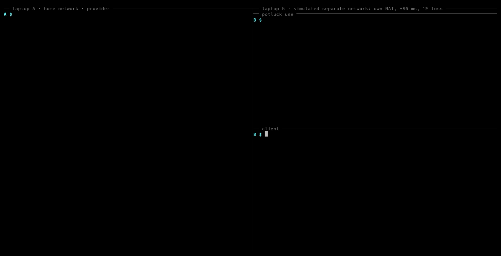

# PotluckLLM

Share local LLMs with your team over peer-to-peer connections. A teammate's GPU machine runs Ollama. You run `potluck use` on your laptop and get an OpenAI-compatible endpoint at `http://127.0.0.1:11500/v1`. Requests travel over an encrypted, hole-punched [Hyperswarm](https://github.com/holepunchto/hyperswarm) connection. There is no cloud API, no open port, no account and no server in the data path. Only public keys listed in the team file can connect, in either direction.



*Recorded on one machine. Laptop B runs in a simulated separate network (its own NAT, no route to A's LAN, 80 ms added delay, 1% loss) made with [`scripts/simnet.sh`](scripts/simnet.sh). Both sides use the public HyperDHT and the real model. Reproduce with `vhs demo/demo.tape`.*

Status: working prototype. Tested on Linux with Node 22. See [PRD.md](PRD.md) for scope and decisions.

## Quickstart

Requires Node 22 or later and pnpm. The provider also needs [Ollama](https://ollama.com) (or another OpenAI-compatible server) listening on localhost.

```sh
git clone https://github.com/jtxmp/potluckllm && cd potluckllm
pnpm install
alias potluck="node $PWD/bin/potluck.js"   # fish: alias potluck "node $PWD/bin/potluck.js"
```

**Every member** prints their public key and sends it to whoever manages the team:

```sh
potluck id
```

**The team owner** creates the team file, adds members, and sends `team.json` to each of them over a private channel:

```sh
potluck team init my-team --member alice
potluck team add bob <bob's public key>
```

**A provider** shares their local models:

```sh
potluck serve        # reads ./team.json, forwards to http://127.0.0.1:11434
```

**A consumer** uses them:

```sh
potluck use          # http://127.0.0.1:11500/v1
curl http://127.0.0.1:11500/potluck/status
curl http://127.0.0.1:11500/v1/chat/completions \
  -H 'content-type: application/json' \
  -d '{"model":"llama3.2:3b","messages":[{"role":"user","content":"Hello"}]}'
```

Any tool that accepts an OpenAI base URL works: set it to `http://127.0.0.1:11500/v1` and use any API key string.

## Why peer-to-peer

The usual ways to reach a GPU machine on another network, and what each costs:

| Option | Data path | Who can connect | What the team gives up |
|---|---|---|---|
| Port forwarding | Direct | Anyone who finds the port | Router access, and Ollama exposed to the internet with no authentication |
| [ngrok](https://ngrok.com) | Through ngrok's cloud service | Anyone with the URL, unless you add auth | Prompts pass through a third party. Free plan: 1 GB transfer out per month |
| [Tailscale](https://tailscale.com) | Direct or via Tailscale relays | Members of the tailnet | Every user signs in through an identity provider. Access is network-level unless ACLs narrow it. Free plan: 6 users |
| [Holesail](https://holesail.io) | Direct, P2P | Anyone holding the shared connection key | Forwards one port. Access comes from holding the key, and the docs describe no per-user identity |
| [AntSeed](https://github.com/AntSeed/antseed) | Direct, P2P | Any buyer on an open market | Built for paid inference between strangers (USDC payments, reputation scores), not for a private team |
| **PotluckLLM** | Direct, P2P | Public keys in `team.json` | Members must trust each other (see threat model) |

Holepunch's stack fits this problem for three reasons. HyperDHT hole-punches through home routers and mobile NAT, so nobody opens a port. Every Hyperswarm connection is Noise-encrypted and authenticated by Ed25519 public key, so the allow-list check is a lookup on the remote key before any data flows. A shared random topic lets members find each other without a server that knows who is on the team.

Sources for the table, checked 2026-10-14: [ngrok pricing](https://ngrok.com/pricing), [ngrok docs](https://ngrok.com/docs/what-is-ngrok/), [Tailscale pricing](https://tailscale.com/pricing), [Holesail docs](https://docs.holesail.io), [AntSeed README](https://github.com/AntSeed/antseed).

## How it works

```
 consumer laptop                                   provider GPU box
 ┌──────────────────────┐                          ┌──────────────────────┐
 │ any OpenAI client    │                          │ Ollama :11434        │
 │   │ http             │                          │   ▲ http (localhost) │
 │   ▼                  │   Hyperswarm topic,      │   │                  │
 │ potluck use          │◀═ Noise-encrypted P2P ══▶│ potluck serve        │
 │ 127.0.0.1:11500/v1   │   hole-punched via DHT   │ allow-list firewall  │
 └──────────────────────┘                          └──────────────────────┘
          both sides load the same team.json (topic + member public keys)
```

- `potluck id` creates an Ed25519 keypair in `~/.potluck/identity.json` (mode 0600).
- `team.json` holds a random 32-byte topic and each member's name and public key. It holds no secrets.
- Providers announce on the topic. Consumers look it up, retrying with backoff until a provider appears.
- Both sides reject any connection whose public key is not in `team.json`.
- Requests and streamed responses travel as newline-delimited JSON over the encrypted stream.
- The consumer routes each request to a provider that lists the requested model.

## Threat model

PotluckLLM protects a team from outsiders on the internet. It does not protect members from each other.

- **Outsiders** cannot connect. A connection from a key outside `team.json` is dropped during the handshake, and the provider logs `reject peer=<key prefix>`. A leaked topic lets an outsider see that peers exist, but not connect.
- **A provider reads your prompts.** It runs the model, so it sees everything it processes. Only send material you would show that person.
- **Members cannot manage the provider's models.** Only `GET /v1/models` and `POST /v1/chat/completions` are forwarded. Ollama admin routes such as `/api/pull` and `/api/delete` return 404.
- **Members cannot exhaust the GPU.** The provider runs one request at a time, queues up to 16, answers 503 beyond that, and aborts a request after 120 s with no output (`--timeout`).
- **Local exposure is minimal.** The consumer endpoint binds to 127.0.0.1. The provider refuses a non-loopback upstream unless you pass `--allow-remote-upstream`.
- **Nothing sensitive is logged.** Logs hold event names, key prefixes, request ids and timings. Prompts and completions are never written to disk.
- **Removing a member** means deleting their entry from `team.json`, sending the new file to everyone, and restarting `serve` and `use`. The team file is read once at startup.

## Measurements

Measured on 2026-10-14. Provider: RTX 3050 Ti Laptop GPU (4 GB), Ollama 0.35.1, `llama3.2:3b` fully on GPU. Six streamed requests per path, after one warm-up request, with the same prompt.

| Path | Median time to first token | Median total time |
|---|---|---|
| Ollama directly | 17.5 ms | 990.5 ms |
| Through potluck, provider and consumer on the same machine, public DHT | 20.5 ms | 996.0 ms |

These numbers cover potluck's own overhead only. Both processes ran on one machine, so the connection did not cross a real network.

### Simulated separate network

Measured on 2026-10-15 with [`scripts/simnet.sh`](scripts/simnet.sh) and [`scripts/rehearse.js`](scripts/rehearse.js). The provider ran on this machine's home network. The consumer ran in its own network namespace behind a user-mode NAT, with no route to the home LAN, so it had to find and reach the provider through the public HyperDHT. Five starts per row, six streamed requests per start. Raw results are in [`rehearsal/`](rehearsal/).

| Consumer network | Starts connected | Median time to provider | Median time to first token | Added vs Ollama directly | Failed requests |
|---|---|---|---|---|---|
| Own NAT | 5 of 5 | 2301 ms | 29.2 ms | 12.4 ms | 0 of 30 |
| Own NAT, 80 ms ± 20 ms delay, 1% loss | 5 of 5 | 3063 ms | 106.1 ms | 89.3 ms | 0 of 30 |

Ollama directly: 16.8 ms median time to first token. Time to provider varies between runs: an earlier run of the same setup measured 4368 ms and 3396 ms.

What this does not cover: both sides still share one public IP, so carrier-grade NAT on a phone hotspot is untested, and the delay applies to the consumer's outgoing traffic only. A two-device rehearsal on separate networks will replace this section.

## Logs

Both commands write one line per event to stderr:

```
2026-10-14T08:33:10.972Z serving team=demo key=5764c223 upstream=http://127.0.0.1:11434
2026-10-14T08:33:12.318Z connect peer=56d29cb3 member=laptop-b
2026-10-14T08:33:36.257Z request peer=56d29cb3 id=6 path=/v1/chat/completions
2026-10-14T08:33:36.274Z first-chunk peer=56d29cb3 id=6 ms=17
2026-10-14T08:33:37.245Z end peer=56d29cb3 id=6 status=200 ms=988
2026-10-14T08:33:45.852Z reject peer=ba11aa2b
```

## Limits

- Linux and macOS only. Windows is untested.
- Your own `potluck use` does not list models from your own `potluck serve`. Call Ollama directly for those.
- Only chat completions and the model list are forwarded. Embeddings and the legacy completions endpoint are not.
- Routing picks the first provider that lists a model. There is no load balancing.
- Some networks block UDP or use NAT that hole-punching cannot cross. Relay fallback is planned (PRD F11).

## Development

```sh
pnpm test                    # 25 integration tests on a local DHT testnet, no GPU or internet needed
node test/fake-ollama.js     # fake OpenAI-compatible upstream on :11434
node scripts/rehearse.js     # measure connect time and latency across real networks (see the file header)
scripts/simnet.sh --profile hotspot -- <command>   # run a command in a simulated separate network (Linux, no root)
vhs demo/demo.tape           # re-record the demo GIF (needs vhs, ttyd, tmux, pasta, Ollama)
```

## License

MIT. See [LICENSE](LICENSE).

## How this was built

See [AI-WORKFLOW.md](AI-WORKFLOW.md) for how AI was used for research, scoping and code, including the ideas that were rejected.
